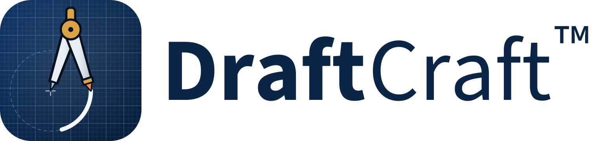
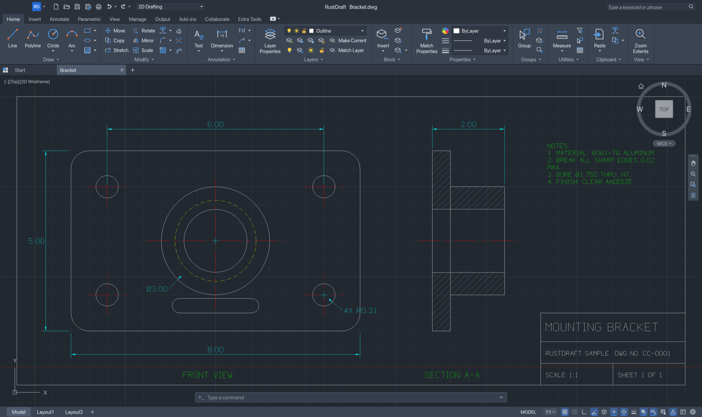
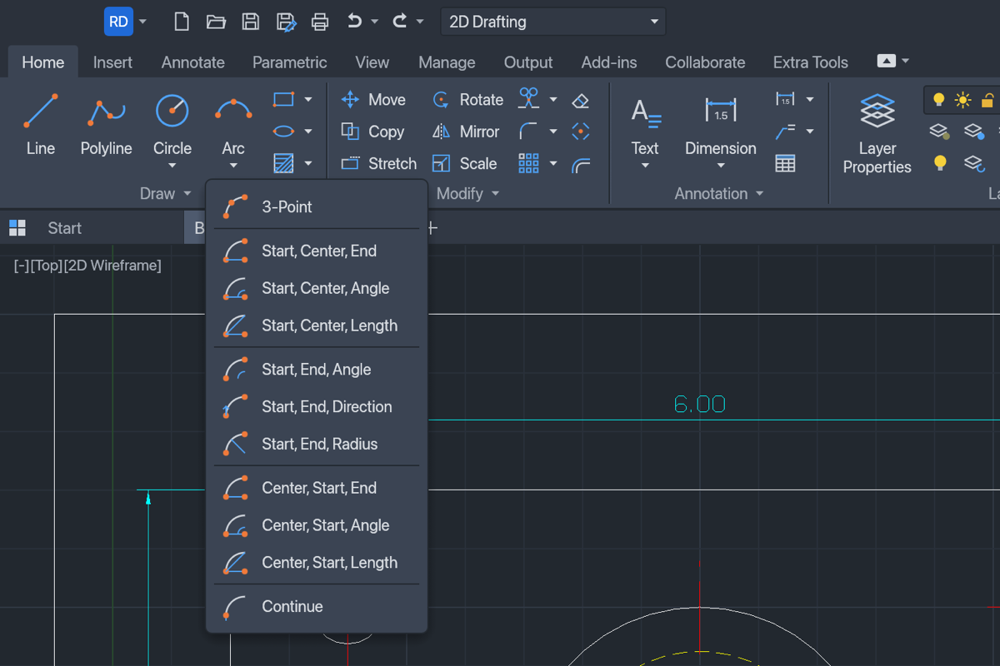
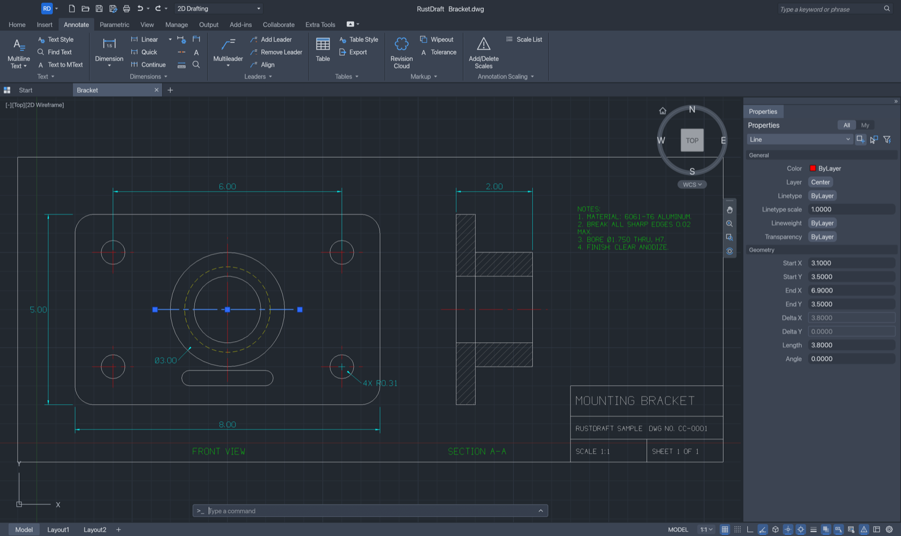
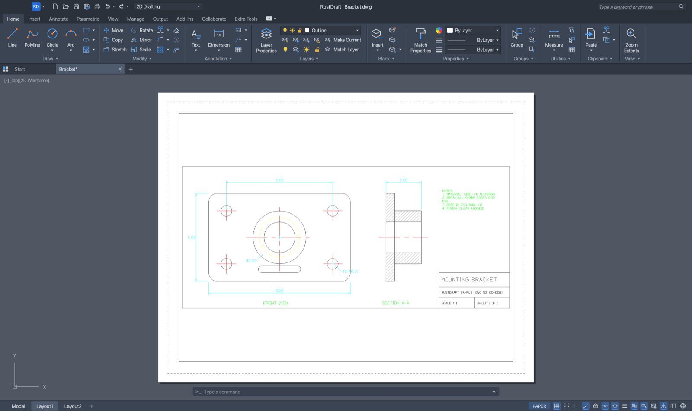

<p align="center">
  <picture>
    <source media="(prefers-color-scheme: dark)" srcset="docs/brand/draftcraft-logo-dark.svg">
    
  </picture>
</p>

<p align="center">
  <a href="https://ko-fi.com/K0O529L823"></a>
  <a href="https://discord.gg/34w9FmQXvz"></a>
</p>

<p align="center">
  Open-source CAD and drafting in pure Rust — with the ribbon you know from AutoCAD on Windows, on every desktop.
</p>

<p align="center">
  <a href="https://github.com/SkryxDev/RustDraft/releases/latest"></a>
  
  
  
</p>

> [!NOTE]
> **DraftCraft™ was RustDraft.** The program is RustDraft by [SkryxDev](https://github.com/SkryxDev), built on
> [CADCraft](https://github.com/storytold/cadcraft); the DraftCraft name and logo are
> [WithShalom Studios](https://github.com/withshalom)' brand, used here by agreement
> ([`docs/brand/LICENSE-brand.txt`](docs/brand/LICENSE-brand.txt)). The rename is under way: the installers, the
> app bundle, the program files and the settings folder still carry the name RustDraft for now.

<p align="center">
  
</p>

---

DraftCraft™ is a 2D CAD application for drafting, dimensioning and plotting drawings, written from the
ground up in Rust. It opens and saves **DWG** and **DXF** files, speaks AutoCAD's command names and prompts
at its command line, and puts everything in a **Windows-style ribbon** — the same on macOS, Windows and
Linux, so you find the tools where you expect them on any computer. It is also built to be driven by
**AI agents**: an MCP server, a JSON control channel and a headless CLI reach the same commands as the
ribbon.

## Features

- **The ribbon** — Home, Insert, Annotate, Parametric, View, Manage, Output, Add-ins, Collaborate and Extra
  Tools, with large, small and split buttons. Circle ▾, Arc ▾, Trim ▾, Fillet ▾, Array ▾ … open a drop-down
  of their methods; panels shrink and fold into a single button from the right when the window is narrow.
- **Familiar layout** — application menu, Quick Access Toolbar, file tabs, a floating command line,
  `[-][Top][2D Wireframe]` viewport label, ViewCube with navigation bar, Model / layout tabs and drafting
  toggles on the status bar.
- **Command line like AutoCAD's** — the same command names and aliases, prompts with clickable keywords,
  AutoComplete, `@dx,dy`, `@d<a`, `#x,y`, direct distance entry, transparent commands and scripts.
- **Draw and modify** — LINE, PLINE, CIRCLE, ARC, RECTANG, POLYGON, ELLIPSE, SPLINE, TEXT, MTEXT and more;
  MOVE, COPY, ROTATE, SCALE, MIRROR, STRETCH, OFFSET, TRIM, EXTEND, FILLET, CHAMFER, ARRAY, grips.
- **Conic arcs** — CONIC draws an exact ellipse, parabola or hyperbola arc from its end points, the apex
  where its tangents meet and a rho value (or a point it passes through): the soft corners of a phone in
  plan view, for example. It is saved as a rational SPLINE, so it opens as a normal spline in AutoCAD and
  any other DXF or DWG program.
- **Precision** — object snaps (endpoint, midpoint, center, intersection, tangent, perpendicular…), polar
  tracking, ortho, grid snap.
- **Layers and properties** — the layer list and colour / linetype / lineweight lists right on the ribbon,
  the Layer Properties Manager and a Properties palette that edits any object.
- **Annotation** — every DIM command with dimension styles, associative dimensions, multileaders, tables,
  TrueType fonts and right-to-left text.
- **Hatches and blocks** — pattern, solid and gradient fills, blocks with attributes.
- **Parametric** — geometric and dimensional constraints, auto-constrain, parameters with expressions.
- **Layouts and plotting** — paper-space layouts with viewports, page setups, PDF plotting, SVG and PNG
  export.
- **Files** — DWG and DXF reading and writing.
- **AutoLISP** — load and run LISP routines, scripts and alias files.
- **18 interface languages**, Italian included, switched live.

## Screenshots

<p align="center">
  
</p>
<p align="center"><em>Split buttons list every method; Arc and Circle picture each one.</em></p>

<p align="center">
  
</p>
<p align="center"><em>Selection grips and the Properties palette, with the Annotate tab.</em></p>

<p align="center">
  
</p>
<p align="center"><em>A layout with a viewport onto the model, ready to plot.</em></p>

## Keyboard shortcuts

On Windows and Linux, <kbd>Ctrl</kbd> takes the place of <kbd>⌘</kbd>.

| Keys | Action |
| --- | --- |
| <kbd>⌘</kbd><kbd>N</kbd> <kbd>⌘</kbd><kbd>O</kbd> <kbd>⌘</kbd><kbd>S</kbd> | New, open, save |
| <kbd>⇧</kbd><kbd>⌘</kbd><kbd>S</kbd> | Save as |
| <kbd>⌘</kbd><kbd>P</kbd> | Plot |
| <kbd>⌘</kbd><kbd>Z</kbd> <kbd>⇧</kbd><kbd>⌘</kbd><kbd>Z</kbd> | Undo, redo |
| <kbd>⌘</kbd><kbd>X</kbd> <kbd>⌘</kbd><kbd>C</kbd> <kbd>⌘</kbd><kbd>V</kbd> | Cut, copy, paste |
| <kbd>⇧</kbd><kbd>⌘</kbd><kbd>C</kbd> <kbd>⇧</kbd><kbd>⌘</kbd><kbd>V</kbd> | Copy with base point, paste as block |
| <kbd>⌘</kbd><kbd>A</kbd> | Select all |
| <kbd>⌘</kbd><kbd>F</kbd> | Find and replace |
| <kbd>⌘</kbd><kbd>1</kbd> | Properties palette |
| <kbd>⌘</kbd><kbd>9</kbd> | Show or hide the command line |
| <kbd>F1</kbd> | Command reference |
| <kbd>F2</kbd> | Command history |
| <kbd>F3</kbd> | Object snap |
| <kbd>F7</kbd> <kbd>F8</kbd> <kbd>F9</kbd> | Grid, ortho, snap |
| <kbd>F10</kbd> <kbd>F11</kbd> <kbd>F12</kbd> | Polar tracking, object snap tracking, dynamic input |
| <kbd>Delete</kbd> | Erase the selection |
| <kbd>esc</kbd> | Cancel the command |
| <kbd>↩</kbd> or <kbd>space</kbd> | Repeat the last command |

Typing works like in AutoCAD: start typing anywhere in the drawing and it goes to the command line.

```text
line 0,0 @10,0 @0,5 c          a closed triangle
circle 5,2 1                    a circle
offset 0.25                     then pick the circle and a side
zoom e                          zoom to the drawing's extents
```

## Install

Download the file for your system from the
[latest release](https://github.com/SkryxDev/RustDraft/releases/latest):

| System | File |
| --- | --- |
| macOS (Apple silicon) | `RustDraft-<version>-macos-arm64.dmg` |
| Windows x64 | `RustDraft-<version>-windows-x86_64.zip` |
| Windows ARM64 | `RustDraft-<version>-windows-arm64.zip` |
| Linux x64 | `RustDraft-<version>-linux-x86_64.tar.gz` |

**macOS** — open the DMG and drag **RustDraft** into **Applications**. The app is not notarized yet, so
macOS blocks it the first time. Open it once, then go to **System Settings › Privacy & Security** and
click **Open Anyway** — or run:

```bash
xattr -dr com.apple.quarantine /Applications/RustDraft.app
```

**Windows** — unzip the folder anywhere and run `RustDraft.exe`. The build is not signed, so SmartScreen
may stop it the first time: click **More info › Run anyway**.
RustDraft draws its own title bar there, with the menu bar in it; set `RUSTDRAFT_TITLEBAR=system` to keep
Windows' own title bar instead.

**Linux** — unpack the archive and run `./rustdraft`. The `share/` folder holds a desktop entry and the
icons for your menu.

Every package also contains `rustdraft-cli`, the headless command-line tool and MCP server.

**Updates** — when DraftCraft starts it asks GitHub whether a newer release is out and, if there is one,
asks whether you want it: **Download** opens the release page. **Help › Check for Updates…** checks at any
time. That one request to `api.github.com` is all DraftCraft sends; set `RUSTDRAFT_NO_UPDATE_CHECK=1` to turn
it off.

## Use it with AI agents

DraftCraft ships an [MCP](https://modelcontextprotocol.io) server. Add it to Claude Desktop, Claude Code
or any MCP client, and the agent draws in the open DraftCraft window while you watch (on macOS it opens
the app when needed):

```json
{
  "mcpServers": {
    "rustdraft": {
      "command": "/Applications/RustDraft.app/Contents/MacOS/rustdraft-cli",
      "args": ["mcp", "--connect", "127.0.0.1:7982", "--launch"]
    }
  }
}
```

The agent types at the command line (`command_line`), runs any command with JSON parameters
(`execute`), reads the drawing (`inspect_drawing`, `query_entities`, `find_text`) and looks at it
(`render`, `screenshot`). `rustdraft-cli mcp` with no `--connect` works on its own, without a window.

The CLI also converts and renders drawings in scripts:

```bash
rustdraft-cli info drawing.dwg
rustdraft-cli convert drawing.dxf drawing.pdf
rustdraft-cli run --sample --script 'CIRCLE 22,3 1\n' --save out.dxf --export out.png
```

More: [MCP](docs/mcp.md) · [CLI](docs/cli.md) · [control channel](docs/control-protocol.md) ·
[LISP, scripts and aliases](docs/customization.md) · [AutoLISP](docs/autolisp.md)

## Build from source

Requirements: **Rust 1.95** or later. On Linux, also the development packages for X11/Wayland and
fontconfig (`pkg-config libxkbcommon-dev libwayland-dev libx11-dev libfontconfig1-dev` on Debian/Ubuntu).

```bash
git clone https://github.com/SkryxDev/RustDraft.git
cd RustDraft
cargo run --release -p rustdraft -- --sample
```

`--sample` opens the sample drawing. To build the app and the CLI without running them:

```bash
cargo build --release -p rustdraft -p rustdraft-cli
```

The programs are written to `target/release/` (`rustdraft` and `rustdraft-cli`). The interface fonts for
Chinese, Japanese, Korean, Arabic, Thai and more come from the optional
[craft-fonts](https://github.com/storytold/craft-fonts) repository: clone it and set
`CRAFT_FONTS_DIR=/path/to/craft-fonts` before building to embed them. Without it DraftCraft uses the fonts
installed on your system.

The quality checks — formatting, clippy, tests, asset licences, crate layering and the web build — run
with:

```bash
cargo xtask ci
```

Releases are built by [the release workflow](.github/workflows/release.yml) when a `v*` tag is pushed;
see [docs/releasing.md](docs/releasing.md).

## How it works

```
crates/
├── geom/          f64 geometry: arcs, bulges, splines, intersections, offsets
├── dxf/           DXF tag reader and writer
├── dwg/           DWG reading and writing
├── color/         colour index and true colour
├── doc/           the drawing database (copy-on-write entities, cheap undo)
├── fonts/         our own stroke font, TrueType and TEXT/MTEXT layout
├── render/        display lists, linetypes, hatches, dimensions, CPU raster
├── constraints/   geometric and dimensional constraint solver
├── io/            DXF/DWG mapping, SVG, PNG and PDF export
├── engine/        sessions, commands, command line and prompts, snaps, selection, undo
├── ui-egui/       the interface: ribbon, canvas, palettes, dialogs
└── mcp/           the MCP server
apps/
├── rustdraft/     the desktop app
├── rustdraft-cli/ the command-line tool
└── rustdraft-web/ a browser build (WebAssembly)
```

- **Everything is a command.** The ribbon, menus, command line, scripts, the CLI, the control channel and
  MCP all run the same commands, defined once in `crates/engine/src/cmd/`.
- **The interface is a thin layer.** Nothing below `ui-egui` knows about the GUI toolkit, and
  `cargo xtask layers` checks it, so the front end can be replaced.
- **It never panics on your data.** Files, typed input and agent requests are treated as hostile; every
  command runs behind a guard that restores the drawing and reports an error instead of crashing.
- **Drawing happens on the GPU** through wgpu (Metal, DirectX 12, Vulkan), with a CPU fallback.
- **No borrowed artwork.** Every icon is drawn in code, and the hatch patterns, linetypes and drafting
  font are DraftCraft's own definitions; [ATTRIBUTION.md](ATTRIBUTION.md) lists every asset file.

Settings, logs and autosaves live in `~/Library/Application Support/RustDraft` on macOS,
`%APPDATA%\RustDraft` on Windows and `~/.config/rustdraft` on Linux.

## Status

DraftCraft is young. 2D drafting, dimensioning, layouts and plotting work; 3D modelling is not there yet,
and some object types that DWG/DXF files can contain can be lost on save. [ROADMAP.md](ROADMAP.md) lists
what works, what is missing and what comes next.

## Found a bug?

Please [open an issue](https://github.com/SkryxDev/RustDraft/issues/new) with what you did, what you
expected and what happened — a screenshot or the drawing helps a lot. The log file is in the `logs`
folder of the settings directory above.

Pull requests are welcome too: fork the repository, make your change on a branch, run
`cargo xtask ci`, and [open a pull request](https://github.com/SkryxDev/RustDraft/pulls).

## License

DraftCraft is licensed under the [MIT License](LICENSE-MIT) or the [Apache License 2.0](LICENSE-APACHE),
at your option. Third-party material is listed in [NOTICE](NOTICE) and [ATTRIBUTION.md](ATTRIBUTION.md).

DraftCraft™ and the DraftCraft logo are trademarks of WithShalom Studios, who first made the name and the
trademark claim. The licences above cover the code, not the name or the logo: you may fork and redistribute
the code, but a modified version should not be presented as DraftCraft. Their terms are in
[docs/brand/LICENSE-brand.txt](docs/brand/LICENSE-brand.txt).

## Credits

Made by **[SkryxDev](https://github.com/SkryxDev)**. The DraftCraft™ name and logo are by
**[WithShalom Studios](https://github.com/withshalom)**.

DraftCraft is based on [CADCraft](https://github.com/storytold/cadcraft) by the ArtCraft Team and the
CADCraft contributors, used under the same MIT OR Apache-2.0 licence; their copyright notice is kept in
[LICENSE-MIT](LICENSE-MIT) and [NOTICE](NOTICE). DraftCraft is an independent project: it is not made,
sponsored or endorsed by them, and it is not affiliated with, sponsored by or endorsed by Autodesk, Inc.
AutoCAD and DWG are trademarks of Autodesk, Inc., named here only to describe compatibility.
